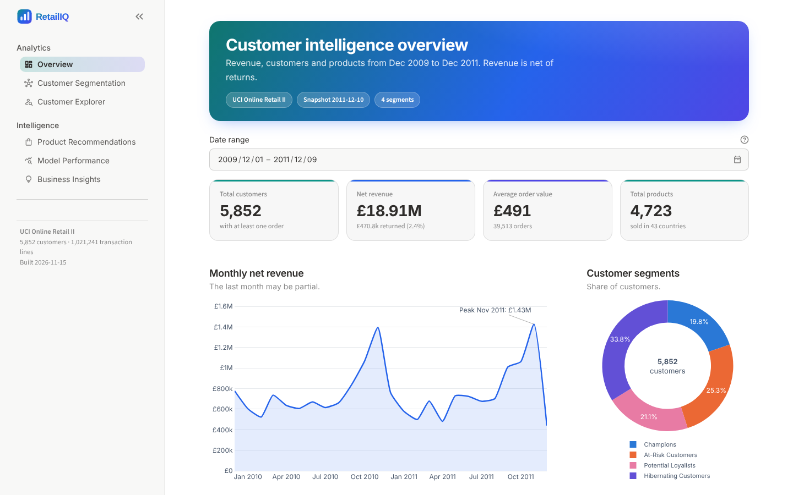
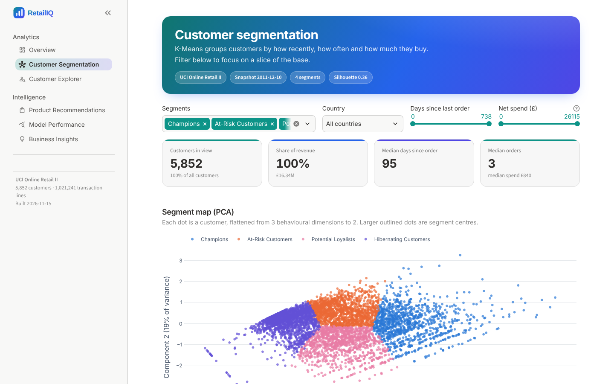
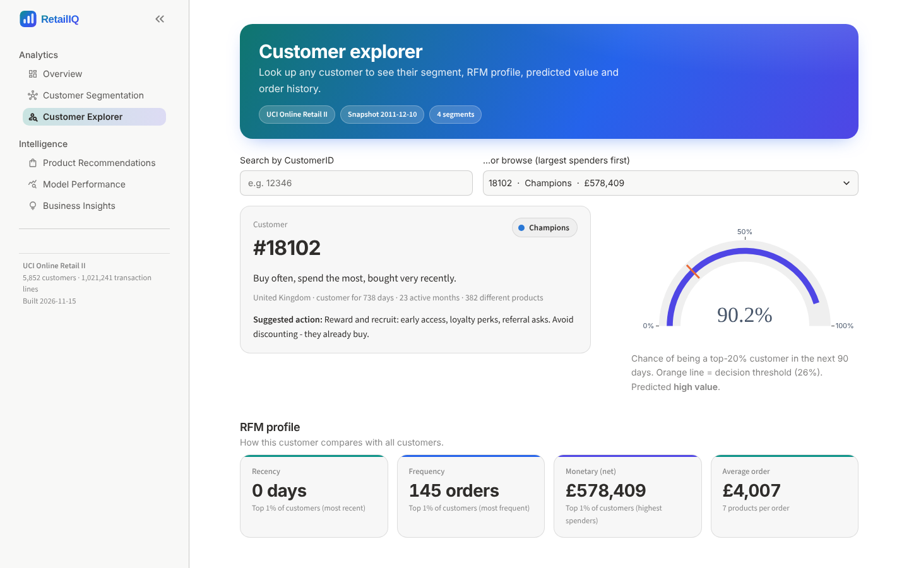
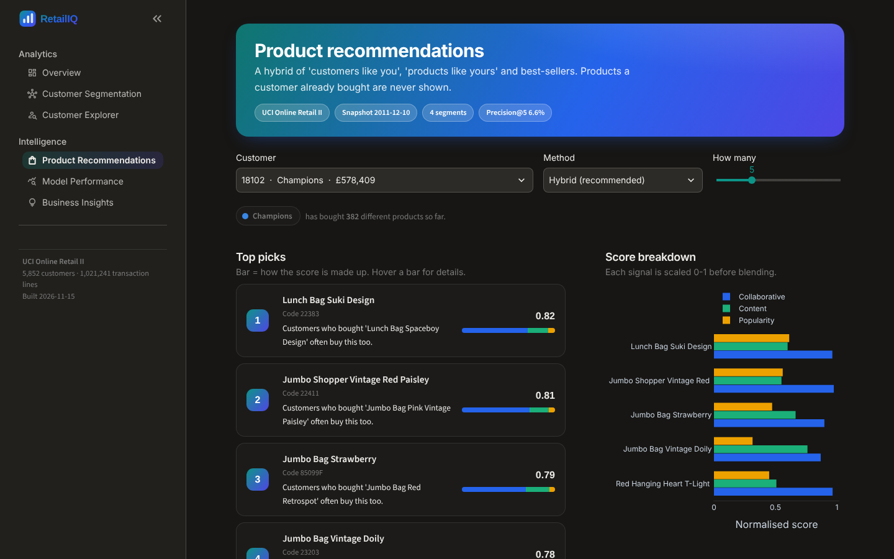
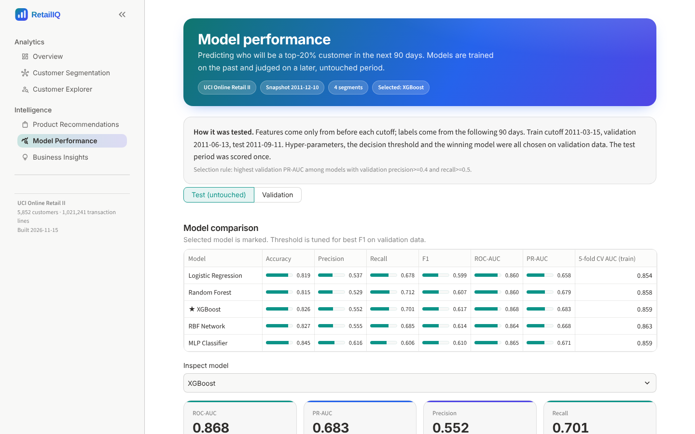

<p align="center"></p>
<h1 align="center">RetailIQ</h1>
<p align="center"><b>Customer segmentation, value prediction and product recommendations for retail - an end-to-end data science project.</b></p>

RetailIQ turns about one million transaction lines from the UCI **Online Retail II** dataset into answers a retailer can act on: *who are our best customers, who is slipping away, who will spend most next quarter, and what should we show them next.* It is built as a learning project: every phase is explained in a notebook, and all reusable logic lives in tested Python modules.



## What is inside

| Area | What it does | Where |
|---|---|---|
| Data pipeline | Loads UCI data, validates it, cleans it (returns kept and netted), writes parquet with before/after reports | `src/data`, [data quality report](docs/data_quality_report.md) |
| Features | RFM + 11 behavioural features at a leakage-safe snapshot date | `src/features` |
| Segmentation | log -> scale -> K-Means, k chosen from data (it found **4**, not 6), labels by archetype matching | `src/models/customer_segmentation.py` |
| Value prediction | Top-20% spend in the next 90 days; logistic regression, random forest, XGBoost, **RBF network (from scratch)**, MLP; temporal train/validation/test | `src/models` |
| Recommendations | Popularity, item-based collaborative filtering, TF-IDF content, 0.6/0.3/0.1 hybrid with explanations and cold-start fallback | `src/recommendations` |
| Insights | Data-derived findings, SHAP / permutation importance, product affinity | `src/analytics` |
| Dashboard | Six-page Streamlit app, Plotly charts, light and dark themes | `app.py`, `pages/` |
| API | FastAPI with Pydantic validation, API-key option, Swagger docs | `api/` |
| Tests | 52 pytest tests including an end-to-end pipeline + API integration test | `tests/` |
| Notebooks | Six executed teaching notebooks | `notebooks/` |

## Results (real, from `models/*.json`)

* **Data:** 1,067,371 raw rows -> 1,021,241 clean rows; net revenue GBP 18.91M; 5,852 customers with purchases.
* **Segments:** Champions are 20% of customers and **73%** of revenue; 1,482 At-Risk customers hold 17% of revenue and have been silent for a median 176 days.
* **Value prediction (test, Christmas quarter, XGBoost selected on validation):** ROC-AUC 0.868, PR-AUC 0.683, precision 0.55, recall 0.70. All five models are within about 0.01 AUC of each other - see the [evaluation report](docs/model_evaluation_report.md).
* **Recommendations (time-aware, new products only):** precision@5 0.066 for the hybrid vs 0.029 for popularity. Absolute numbers are low by design; read the limitations in the report.

| Segmentation | Customer explorer |
|---|---|
|  |  |
| **Recommendations (dark)** | **Model performance** |
|  |  |

## Quick start

```bash
python3.11 -m venv .venv && source .venv/bin/activate
pip install -r requirements-dev.txt
python scripts/download_data.py        # official UCI file -> data/raw/  (or place online_retail_II.xlsx there)
python scripts/run_pipeline.py         # about a minute: all artefacts
python -m pytest                       # 52 tests
streamlit run app.py                   # dashboard on :8501
uvicorn api.main:app --reload          # API on :8000, docs at /docs
```
Prefer to skip the download? The repo already contains the processed data and trained models, so `streamlit run app.py` works immediately. Shortcuts are in the `Makefile`.

## Learning path
1. `notebooks/01_data_understanding` -> 2. `02_exploratory_data_analysis` -> 3. `03_customer_feature_engineering` -> 4. `04_customer_segmentation` -> 5. `05_customer_value_prediction` -> 6. `06_recommendation_engine`.
Each opens with a seven-question briefing (what, why, real-world problem, code, expected output, what can go wrong, how professionals do it) and ends with check-yourself questions.

## Documentation
[Dataset](docs/dataset_documentation.md) - [Architecture](docs/architecture.md) - [ML methodology](docs/ml_methodology.md) - [Model evaluation](docs/model_evaluation_report.md) - [Data quality](docs/data_quality_report.md) - [Deployment](docs/deployment.md)

## Honest notes
* **Data source for the committed results:** a GitHub-hosted copy of Online Retail II (row count and date range match UCI; not byte-compared). Re-run with the official download to reproduce on your own copy.
* **Tested on Python 3.13** (versions in `requirements-lock.txt`) **and Python 3.11.18** (fresh venv from `requirements-dev.txt`: all 52 tests pass and the committed models load in the API).
* **Not performed here:** Docker build and the Streamlit Cloud / Render deployments (they need your accounts). The files are provided and documented.
* Model files are pickles: regenerate them with `make pipeline` if you use other library versions.

Data: UCI Online Retail II (CC BY 4.0). Code: add the licence of your choice before publishing.
